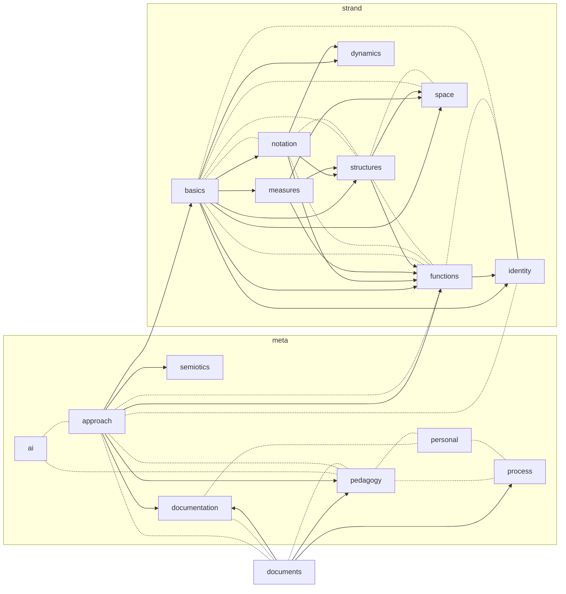

# documents

**in short.** how these docs are organized and written: domains, subdomains
and their stripes of chapters, topics that cut across them, the shape every
chapter shares, the concept index and its IDs, frozen versions, the labels
that say how something is known, and the writing conventions. it's the place
to start. why the docs are written at all, and what documentation is for, is
in [the meta domain](meta/documentation.md).

the concepts here are listed, with stable IDs, in [concepts.md](concepts.md).

## domains and stripes

a **domain** is one subject the docs cover. so far there are two: the meta
domain, about how all of it is thought through and made, and strands. a domain
can have **subdomains**, parts with a subject of their own. a domain's files
are its **stripe**:

    documentation/
      documents.md        this file
      concepts.md
      meta/               the meta domain, one file per subdomain
        personal.md  approach.md  semiotics.md  pedagogy.md
        documentation.md  ai.md  process.md
      strand/             the strand domain
        basics.md  notation.md  measures.md  structures.md
        functions.md  dynamics.md  identity.md  space.md
        spacer_v0.md      frozen

structure is added once it's earned (see "structure follows use", in
[the approach](meta/approach.md)):

- a domain starts as **one file** at the top, named after it. once it has
  several files, it becomes **a folder**, and its files are named for their
  subjects. a subdomain is one file inside its domain's folder, and becomes a
  folder of its own the same way
- nesting follows use, not taxonomy. a strand is a kind of discrete space,
  which is a kind of space, but that ancestry is stated in words, in the
  strand basics, not built into folders
- the files at the top that aren't domains cover every domain: this one, and
  [concepts.md](concepts.md)

file names carry no numbers. a number would say "this comes before that" and
nothing else, but the files relate in richer ways: some build on others, some
lean on each other, and some can be read in any order. the order is shown
instead, in the map below and in each section's **builds on**.

## the map

an arrow points from a file to a file that builds on it. a dotted line joins
two files that lean on each other: each refers to the other, so neither
simply comes first.

a **suggested path**, one good way through and not the only one: in meta,
personal, approach, semiotics, pedagogy, documentation, ai, process; in strand,
basics, notation, measures, structures, functions, dynamics, identity, space.

## cross-cutting topics

many topics cut across domains: pedagogy matters to AI, AI to pedagogy, and
naming to everything. rather than file each topic in one place and nowhere
else, a topic has one home and any number of framings:

- **home**: the topic's foundational, abstract treatment lives in exactly one
  place, its home subdomain. pedagogy's foundations are in `meta/pedagogy.md`
- **framing**: another domain or subdomain can treat the topic from its own
  side, such as "pedagogy, from AI", in `meta/ai.md`. a framing builds on the
  home, and links to it rather than restating it
- **no duplicate definitions**: a framing applies the home's concepts, or
  extends them. anything new it defines gets its own concept ID, where it's
  defined
- **both directions**: the home lists its framings under "seen from
  elsewhere", so a reader can find every side of a topic
- **size**: a framing starts as a section, and becomes a chapter of its own
  when it grows

it's the idea of more than one perspective (see "more than one perspective",
in "approach"), applied to the docs themselves.

## the shape of a chapter

each chapter opens the same way:

- a title, in plain words
- **in short**: what the chapter covers, in a few plain sentences
- a pointer to the concept index

dependencies are kept where they're used, like imports in a module: a section
that uses concepts from another file says so in a **builds on** line under its
heading, naming the concepts and where they're from. a section that needs
nothing from elsewhere has no such line. the lines are drawn from the concept
index, where every concept lists what it builds on.

definitions have to bottom out: following "builds on" from concept to concept
must never come back to where it started. the concept index makes that
checkable. understanding is different, and can go round: two chapters can
refer to each other, and the map shows where they do.

## concepts and their IDs

every concept the docs define is listed in [concepts.md](concepts.md),
with:

- a stable **ID**: C and a number. numbers are given in order, and never reused
  or renumbered: a renamed concept keeps its ID, and a retired one leaves a gap
- its former names, so older notes can still be read
- a line in plain words, and the IDs of the concepts it builds on

a new concept gets the next free number, whichever chapter it's in.

## frozen versions

a whole draft can be **frozen**: `strand/spacer_v0.md` is the first draft of
the strand domain, from when it was called spacer, kept exactly as it was when
the chapters were split from it. a frozen version is never edited. it's a
record of how the ideas stood, not part of the docs.

## status labels

how something is known is said where it's claimed (see "honesty about status",
in "approach"):

- **_from memory_**: recalled, and not yet checked
- **checked by computation**: with how far the check went, such as "369 of
  369 families up to 60 cells", in `rough/PRIOR_WORK.md`
- **deferred**: noted on purpose, and left for later
- **established names**: given as handles for searching, not as authorities

## writing conventions

- plain words first. a technical term comes with a plain explanation, or is
  paired with an established or alternative name at first use:
  arrangement/distribution (see "plain words first", in pedagogy)
- the docs are written in lowercase, headings and the starts of sentences
  included. names written in code keep their case: `Rotate`, `S`
- the personal chapters are written in the first person, because they're
  about who's writing. the rest are impersonal, though they carry the same
  perspective
- notation goes in code formatting, so that no host format can read it as
  formatting of its own (see "inside other formats", in "notation")
- labels in examples belong to their example
- lines are wrapped at 80 characters, except in tables and code blocks
- a cross-reference names the section in quotes, and the chapter if it's
  another one: (see "weights", in "structures")

## rough notes

the `rough/` folder holds working notes, such as `PRIOR_WORK.md`: leads,
established names and ideas to explore, collected along the way. they aren't
docs, and can be wrong.

## to come

- figures, generated from one script
- a crosswalk from these docs to established fields, and a doc of the
  established mathematics
- a test set, then implementations
